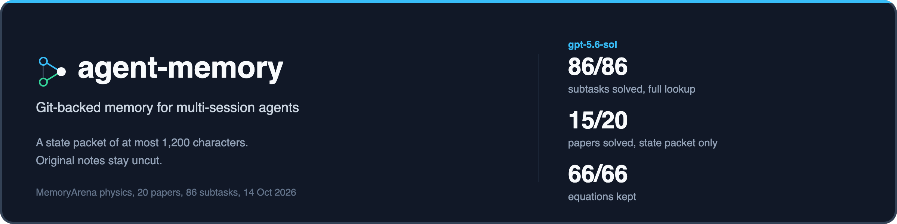

Local Git-backed memory for agents that work across sessions.

Every turn the agent receives a state packet of at most 1,200 characters (about 200 tokens). The packet is rendered from the notebook, with no model call. When that is not enough, one `memory_find` call returns the original note.

- **State packet.** Goal, steering, handoff, open questions, and related notes.
- **File lineage.** Each note is a Git commit. Declared files are hashed, and a later edit marks the note `[stale]`. `memory_inspect` opens the saved snapshot.
- **Compression.** `memory_summarize` folds finished steps into one summary.

[Overview (PDF)](paper/agent_memory_overview.pdf) · [Technical paper (PDF)](paper/agent_memory_paper.pdf) · [Paper (Markdown)](paper/PAPER.md)

## Results

[MemoryArena](https://huggingface.co/datasets/ZexueHe/memoryarena) `formal_reasoning_phys` (ICML 2026): 20 physics papers, 86 subtasks, chains up to 12 steps. Figures below are from [`benchmarks/memoryarena/results_2026_10_14.json`](benchmarks/memoryarena/results_2026_10_14.json) (14 Oct 2026).

Success rate is the share of papers whose last subtask is correct. Progress is the share of subtasks solved.

### Papers solved

| System | Model | Success | Progress | Memory tokens |
| --- | --- | ---: | ---: | ---: |
| agent-memory, one full lookup | gpt-5.6-sol | 100% (20/20) | 100% | 968 |
| agent-memory, state packet only | gpt-5.6-sol | 75% (15/20) | 85.8% | 197 |
| no memory | gpt-5.6-sol | 35% (7/20) | 59.3% | 0 |
| agent-memory, one full lookup | gpt-5-mini | 50% (10/20) | 60.2% | 1,435 |
| agent-memory, state packet only | gpt-5-mini | 50% (10/20) | 56.9% | 198 |
| BM25 chunks, same harness | gpt-5-mini | 25% (5/20) | 50.5% | 244 |
| Mem0-style facts, same harness | gpt-5-mini | 15% (3/20) | 38.9% | 109 |
| no memory | gpt-5-mini | 5% (1/20) | 32.2% | 0 |

On `gpt-5.6-sol`, step 1 is already 20/20, and one full lookup then passes all 86 subtasks. The state packet alone finishes 15 of 20 papers, at 197 memory tokens and no tool call. On `gpt-5-mini`, step 1 is 12/20. One full lookup finishes 10 of 20 papers, against 1 of 20 with no memory.

Published MemoryArena physics rows, for context (not rerun in this repo): Letta / MemGPT 45% success and 65% progress; GPT-5.1-mini long context 45% and 60%.

### Depth on gpt-5.6-sol

Subtasks passed. The count of papers still in the chain drops as the step number rises.

| Step | Papers | No memory | State packet | Full lookup |
| ---: | ---: | ---: | ---: | ---: |
| 1 | 20 | 20 | 20 | 20 |
| 2 | 20 | 9 | 18 | 20 |
| 4 | 10 | 4 | 6 | 10 |
| 8 | 3 | 2 | 2 | 3 |
| 12 | 1 | 0 | 0 | 1 |

Full lookup passes every step, including steps 11 and 12 of the 12-step paper. The state packet misses those two steps.

### Equations kept

Exact ground-truth equation recall on the 66 subtasks that depend on an earlier step. Prompt size is the memory text for that subtask, in estimated tokens.

| System | Recall | Prompt tokens |
| --- | ---: | ---: |
| no memory | 10.4% | 66 |
| Mem0-style facts | 37.0% | 187 |
| BM25 chunks | 53.9% | 374 |
| agent-memory, state packet | 52.5% | 338 |
| agent-memory, one full lookup | 100% | 1,565 |

```bash
python3 examples/memoryarena_online_benchmark.py --official-gpt5mini
```

## Install

```bash
pip install "agent-memory[cursor] @ git+https://github.com/dorianherle/agent_memory.git@main"
cd your-project
agent-memory cursor install
```

Reload MCP in Cursor Settings, then Tools & MCP, and open a new Agent chat.

Or paste this into a Cursor agent:

```text
Install agent-memory in this project (.venv/bin/python -m pip install "agent-memory[cursor] @ git+https://github.com/dorianherle/agent_memory.git@main") and run `.venv/bin/python -m agent_memory.cli cursor install --python .venv/bin/python --skip-gemini --no-interactive`. Verify `.cursor/mcp.json`, `.cursor/hooks.json`, and `.agent_memory/` exist, and ensure `.agent_memory/` is in `.gitignore`.
```

For semantic search on top of local SQLite FTS5, pass `--gemini-api-key "$GEMINI_API_KEY"` instead of `--skip-gemini`.

## Use

### Cursor

After install, each turn includes a `# MEMORY STATE` block:

```text
## Goal
[a1b2c3d4] Fix duplicate checkout writes

## Steering
[e5f6a7b8] Keep the public API unchanged

## Handoff
[11111111] Idempotency patch ready
Rejected: blind retry duplicates writes.
Next: pytest tests/test_checkout.py -k retry

## Open questions
[22222222] Does the timeout fixture reproduce production?
```

| Tool | What it does |
| --- | --- |
| `memory_save` | Save a finding, decision, or handoff |
| `memory_find` | Search notes. `full=True` returns the uncut body |
| `memory_summarize` | Fold finished notes into one summary |
| `memory_open_questions` | Track or close an open question |
| `memory_inspect` / `memory_branch` | Open an older snapshot, or continue from it |
| `memory_goal_create` / `memory_goal_list` / `memory_goal_use` | Isolated goal workspaces |

The live timeline is `.agent_memory/live/index.html`.

### Python

```python
from openai import OpenAI
from agent_memory import Memory, wrap

mem = Memory(".")
mem.save("Fix duplicate checkout writes", {"goal": True})

client = wrap(OpenAI(), mem)
resp = client.chat.completions.create(
    model="gpt-5",
    messages=[{"role": "user", "content": "Why does checkout double-charge?"}],
)
```

### Cursor SDK

```python
from cursor_sdk import Agent, LocalAgentOptions

with Agent.create(
    model="composer-2.5",
    local=LocalAgentOptions(cwd=".", setting_sources=["project"]),
) as agent:
    print(agent.send("What do we already know?").wait().result)
```

## Citation

Dorian Herle (`herle.dorian@gmail.com`)

```bibtex
@article{herle2026agentmemory,
  title  = {Agent Memory: Deterministic Bounded State Packets, Git-Snapshot Lineage, and Consecutive Compression for Long-Horizon AI Agents},
  author = {Herle, Dorian},
  year   = {2026},
  month  = {October},
  url    = {https://github.com/dorianherle/agent_memory}
}
```
