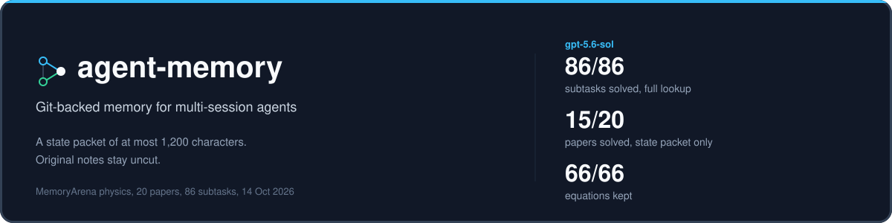
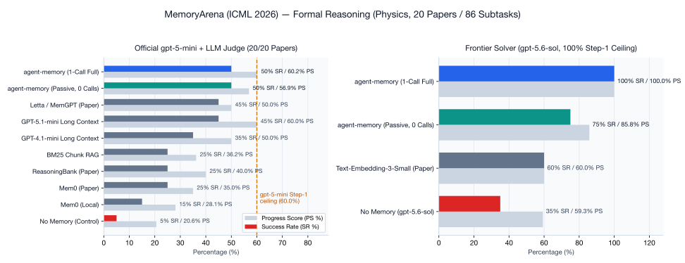

<div align="center">



**[📘 General Overview (PDF)](paper/agent_memory_overview.pdf)** · **[📄 Technical Paper (PDF)](paper/agent_memory_paper.pdf)** · **[📖 Paper (Markdown)](paper/PAPER.md)** · **[⚡ Install](#install)** · **[🛠️ How to Use](#how-to-use)** · **[🏆 Benchmarks](#benchmark-results)**

*Author: **Dorian Herle** (`herle.dorian@gmail.com`)*

</div>

---

**`agent-memory`** is a local, Git-backed memory system for AI agents that work across long, multi-session tasks.

Long-context chat buffers rot and explode in token cost. External fact extractors (`Mem0`) paraphrase away exact equations and code constants. Fixed-window RAG (`BM25` / vector chunks) slices multi-line definitions in half.

**`agent-memory` fixes this with three mechanisms:**
1. **Bounded State Packet (`<= 1,200 chars`):** Every turn injects a deterministic `# MEMORY STATE` view (`Goal`, `Steering`, `Handoff`, `Open questions`, `Related`) in **~200 tokens with 0 LLM calls**.
2. **Git Snapshot Lineage:** Every saved note is a commit in an isolated Git DAG with SHA-256 file hashes—giving agents automatic `[stale]` warnings when files change and time-travel (`memory_inspect` / `memory_branch`).
3. **Consecutive Compression & 1-Call Full Retrieval:** Completed steps fold into rolling summaries (`memory_summarize`), while `memory_find(query=..., full=True)` retrieves uncut note bodies with **100% equation & symbol recall**.

---

## Benchmark Results

Evaluated on the [**ICML 2026 MemoryArena (`formal_reasoning_phys`)**](https://huggingface.co/datasets/ZexueHe/memoryarena) benchmark (**all 20 multi-session physics papers, 86 interdependent subtasks, chain depths up to $k=12$**):



- **#1 Overall (Frontier `gpt-5.6-sol` Backbone, 20/20 Papers):** **`100.0%` Success Rate (SR) / `100.0%` Progress Score (PS)** (`86/86` subtasks solved, `968` avg memory tokens)—and **`75.0%` SR / `85.8%` PS** in passive **0-tool-call** mode (`197` avg memory tokens).
- **#1 External Memory (Official `gpt-5-mini` + `MathEnvironment.judge()`, 20/20 Papers):** **`50.0%` SR / `60.2%` PS** (retaining **83%** of `gpt-5-mini`'s `60%` single-turn math ceiling), beating `Letta / MemGPT` (`45.0%` SR), `GPT-5.1-mini Long Context` (`45.0%` SR), `BM25` (`25.0%` SR), and `Mem0` (`15.0%`–`25.0%` SR).
- **100.0% Symbolic Recall:** Preserves **100.0%** of ground-truth LaTeX equations across all 66 dependent subtasks (vs. `53.9%` for BM25 chunking and `37.0%` for Mem0 fact extraction).

```bash
# Reproduce the full 20-paper benchmark
python3 examples/memoryarena_online_benchmark.py --official-gpt5mini
```

---

## Install

### Option 1: Install in Cursor (CLI)

```bash
pip install "agent-memory[cursor] @ git+https://github.com/dorianherle/agent_memory.git@main"
cd your-project
agent-memory cursor install
```

Then reload MCP in **Cursor Settings → Tools & MCP** and open a new Agent chat.

### Option 2: Paste this prompt into your Cursor Agent

```text
Install agent-memory in this project (.venv/bin/python -m pip install "agent-memory[cursor] @ git+https://github.com/dorianherle/agent_memory.git@main") and run `.venv/bin/python -m agent_memory.cli cursor install --python .venv/bin/python --skip-gemini --no-interactive`. Verify `.cursor/mcp.json`, `.cursor/hooks.json`, and `.agent_memory/` exist, and ensure `.agent_memory/` is in `.gitignore`.
```

*(Want semantic search in addition to local SQLite FTS5? Pass `--gemini-api-key "$GEMINI_API_KEY"` instead of `--skip-gemini`.)*

---

## How to Use

### 1. In Cursor (Automatic via Hooks + MCP)

Once installed, `agent-memory` works automatically:
- **Every turn**, the agent sees a compact `<= 1,200`-character `# MEMORY STATE` packet in its system rules:

```text
## Goal
[a1b2c3d4] Fix duplicate checkout writes

## Steering
[e5f6a7b8] Keep the public API unchanged

## Handoff
[11111111] Idempotency patch ready
Rejected: blind retry duplicates writes.
Next: pytest tests/test_checkout.py -k retry

## Open questions
[22222222] Does the timeout fixture reproduce production?
```

- **During work**, the agent uses MCP tools to save checkpoints, search full notes, compress completed steps, or inspect old file snapshots:

| MCP Tool | What it does |
| :--- | :--- |
| `memory_save` | Save a finding, decision, or handoff (`files=[...]`, `handoff=True`, or `payload={...}`) |
| `memory_find` | Search notes by query or ID (`memory_find(query="...", full=True, limit=5)` for uncut bodies) |
| `memory_summarize` | Compress completed notes into a single rolling summary commit |
| `memory_open_questions` | Track or close unresolved blockers |
| `memory_inspect` / `memory_branch` | Rewind working files to an earlier memory snapshot or branch from it |
| `memory_goal_create` / `memory_goal_list` / `memory_goal_use` | Create and bind isolated goal workspaces |

- **Live Browser View:** Open `.agent_memory/live/index.html` to watch the memory timeline update in real time.

### 2. In Python (OpenAI SDK Wrapper)

Wrap any OpenAI-compatible client in 2 lines to inject `# MEMORY STATE` before every turn:

```python
from openai import OpenAI
from agent_memory import Memory, wrap

mem = Memory(".")
mem.save("Fix duplicate checkout writes", {"goal": True})

client = wrap(OpenAI(), mem)
resp = client.chat.completions.create(
    model="gpt-5",
    messages=[{"role": "user", "content": "Why does checkout double-charge?"}],
)
```

### 3. In Cursor SDK

```python
from cursor_sdk import Agent, LocalAgentOptions

with Agent.create(
    model="composer-2.5",
    local=LocalAgentOptions(cwd=".", setting_sources=["project"]),
) as agent:
    print(agent.send("What do we already know?").wait().result)
```

---

## Paper & Citation

- **General Audience Overview (PDF):** [`paper/agent_memory_overview.pdf`](paper/agent_memory_overview.pdf) ([LaTeX Source](paper/agent_memory_overview.tex)) — *"Giving AI Assistants a Reliable Notebook"*
- **Technical Paper (PDF):** [`paper/agent_memory_paper.pdf`](paper/agent_memory_paper.pdf) ([LaTeX Source](paper/agent_memory_paper.tex) · [Markdown](paper/PAPER.md)) — *"Agent Memory: Deterministic Bounded State Packets, Git-Snapshot Lineage, and Consecutive Compression for Long-Horizon AI Agents"*

```bibtex
@article{herle2026agentmemory,
  title   = {Agent Memory: Deterministic Bounded State Packets, Git-Snapshot Lineage, and Consecutive Compression for Long-Horizon AI Agents},
  author  = {Herle, Dorian},
  year    = {2026},
  month   = {October},
  url     = {https://github.com/dorianherle/agent_memory}
}
```
