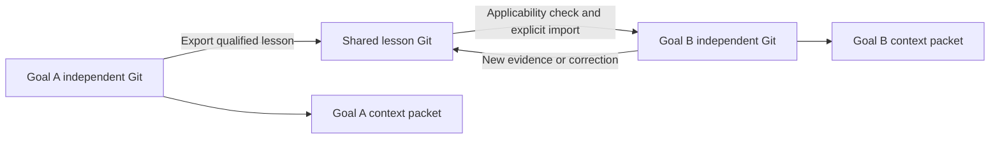

# Isolated goal graphs and deterministic learning

Design proposal, 2026-09-09. Runtime implementation is not included in this
review. See the [subsystem audit](../audits/2026-09-09-clean-context-review.md)
for source findings, reproductions, and measured limits.

For a sequential introduction with a worked example, read the
[Agent Memory white paper](agent-memory-explained.html). It explains the problem
and learning mechanism before the technical architecture below.

## Product contract

Agent Memory supports a long-running goal across many agents, chat sessions,
context resets, interruptions, and alternative attempts. A project can have
several goals in progress. Each goal graph has its **own independent Git
repository**, and each concurrently executing goal has a separate working
directory. Switching subjects selects a different graph while preserving the
original goal's progress.

Cross-learning transfers selected, evidence-backed lessons with their original
conditions. It does not require replaying another goal's conversation. A fresh
agent receives the goal contract, current frontier, relevant evidence,
applicable lessons, and next action within a bounded context packet.

“Task” in the initial audit means a persistent goal space. A turn or a new chat
does not create a new goal by itself.

## The identities that must stay distinct

| Identity | Meaning |
|---|---|
| Project | Shared source/project identity and registry of available goals |
| Goal | Stable objective, acceptance criteria, constraints, own Git graph |
| Subject | Retrieval tag such as authentication or build tooling; a tag can span goals |
| Attempt | A proposed approach within one goal, with its own outcome and optional branch |
| Session | One host/agent instance, explicitly bound to a goal and attempt |
| Turn | One new user question and its temporary execution context |
| Code baseline | Source revision plus dirty-file manifest and environment/test identity |

Subject similarity can suggest a goal or lesson. It cannot silently rewrite the
goal contract. A goal can span several subjects, and two goals on the same
subject can have different constraints.

## Physical isolation

Conceptual layout; exact filenames may change during implementation:

```text
project/
  .agent_memory/
    registry.sqlite3                 # routing, graph locations, bindings
    shared/
      lessons.git/                   # independently versioned promoted lessons
      catalog.sqlite3
    goals/
      <goal-id>/
        memory.git/                  # independent HEAD, refs, objects, index
        catalog.sqlite3              # derived from this goal's Git events
        vectors/                     # this goal's optional derived index
        workspace/                   # this goal's isolated project files
        runtime/                     # per-goal leases, checks, diagnostics
        live/                        # derived view of this goal
```

Each goal owns its Git directory, refs, lock, catalog, check state, and inspection
state. An attempt branch stays inside that goal's repository. The registry
contains graph discovery and session bindings; it must not become a substitute
shared graph containing every goal's raw memory.

All commands receive an explicit validated graph binding. Resolve paths from
opaque IDs in the registry, never from a guessed title or a process-global
“latest goal.” A host can keep several graph handles open simultaneously.

Current `Memory` already creates independent Git stores when given separate
project directories. The isolation probe verifies that branching one such
store leaves the other store's HEAD, files, and retrieval unchanged. Build on
that boundary. It currently lacks the registry, graph routing, separate Git-dir
configuration, and cross-learning layer.

Code workspaces need equal care: two independent memory Git directories pointed
at the same mutable source tree still interfere during restores. Default
parallel execution should use separate workspace copies/independent source
clones. A host that cannot route edits to the bound workspace can provide memory
isolation, but must not advertise isolated concurrent execution.

Initialize a goal from a recorded source baseline. Record the original commit
and any deliberately included uncommitted changes; exclude credentials and
generated files. Publish completed source changes back as an explicit patch or
reviewable integration operation. Switching the active goal should only change
the session binding and packet, not rewrite the user's main checkout.

## What each goal graph stores

### Goal contract

The objective and its version, acceptance criteria, user constraints, permitted
scope, optional resource budget, and completion policy. Distinguish machine
verifiable criteria from criteria requiring human judgment. “Make it amazing”
needs concrete acceptance cases before any deterministic completion guarantee.

New steering appends a versioned change to this contract. It does not erase
the original objective or transfer another goal's constraints into it.

### Frontier and handoff

Keep the active subproblem, dependencies, unresolved hypotheses, next useful
action, checkpoint references, and observed progress toward each criterion.
Use a dependency graph: a subproblem can be blocked, ready, in progress,
verified, invalidated, or abandoned with evidence. A summary is a view of this
state; it is not the sole representation of it.

This is central to long-horizon work. A restored agent must recover both the
goal and the exact incomplete subproblem. Finished knowledge alone is not enough.

### Attempts and outcomes

Record an attempt's proposed change/workflow, preconditions, source tree,
environment fingerprint, commands, evidence, and outcome. Outcomes distinguish
`pass`, `fail`, `inconclusive`, and `interrupted`. Failed setup, an unavailable
service, and a failed acceptance assertion are different events.

A check result refers to the exact tested state. If files change during a check,
the result cannot certify the new tree. A successful subprocess exit is useful
evidence only for what that subprocess actually verified.

### Observations, decisions, and constraints

Use separate record kinds for observed facts, explicit user requirements,
engineering decisions, untested hypotheses, and reusable procedures. Each
record has provenance, applicability conditions, evidence references, and
supersession links. An agent's assertion that something was verified is not
itself verification.

Preserve concise rationales and evidence rather than private chain-of-thought.
Raw episode events remain retrievable for investigation, outside the normal
startup packet.

## Proposed refinement: semantic, procedural, and episodic memory

Separate memory by purpose within each goal's independent Git repository. Goal
ownership and memory type are different dimensions: a fact, workflow, episode,
and active subproblem can all belong to the same goal and share provenance.

| Layer | Question answered | Representation and retrieval |
|---|---|---|
| Semantic knowledge | What is known, and under which conditions? | Typed facts, entities, relations, decisions, validity intervals, evidence links; lexical lookup plus bounded graph expansion |
| Procedural knowledge | How can this objective be achieved? | Versioned workflows with inputs, preconditions, steps/branches, postconditions, verifiers, and observed outcomes; match by intended effect and applicability |
| Episodic evidence | What actually happened? | Append-only attempts, tool results, observations, source snapshots, and outcomes; retrieve specific episodes when needed |
| Working goal state | What are we trying to do, and what remains? | Goal contract, dependency frontier, current hypotheses, pending actions, latest handoff; normally included at startup |

The semantic/episodic/procedural distinction is established terminology in agent
memory systems. This proposal keeps procedural knowledge as explicit validated
workflows, and the working goal state as a separate operational projection.
[LangChain memory concepts](https://docs.langchain.com/oss/python/concepts/memory).

### The two graphs have different jobs

The **Git graph** records history and alternative attempts for a goal. The
**knowledge graph** records entities, claims, and their relationships. A
procedure may itself contain an execution/dependency graph. These structures
should have explicit links; their edge semantics are not interchangeable.

Knowledge-graph extraction is a method for building semantic memory, rather
than an alternative memory category. Prefer typed claims with evidence and
scope over bare triples that discard conditions. A claim needs both when it
was observed and the period/revision in which it applies; a superseded claim
remains available historically. Temporal knowledge graphs are one researched
approach to this problem.
[Zep temporal memory architecture](https://arxiv.org/abs/2501.13956).

Useful relationships include `supported_by`, `depends_on`, `supersedes`,
`contradicts`, `requires`, and `verified_by`. Avoid unrestricted extraction of
every entity or loosely inferred relation from every chat message.

Example:

```text
Fact F: this revision's build target is make verify
Evidence E: build configuration at a recorded path and content hash
Procedure P: validate a change using the matching environment and build target
Episode R: P ran against tree T and returned a recorded test result
Dependencies: F supported_by E; P requires F; R evaluates P
```

If the build configuration changes, F needs revalidation and P's applicability
must be reconsidered. R remains a valid historical account of that earlier run.
The procedure has no authority to override the current goal's user constraints.

### Write once, derive incrementally

Commit the durable episode and essential handoff first. Extract useful
candidate facts and workflows incrementally from the new material. Validate
them and append their typed records with source-event and extractor-version
references. Build separate query projections from those records.

Deterministic parsers can extract supported relationships from configuration,
ASTs, and structured tool results. Prose extraction can require a model; its
output is a proposal and must not be called deterministic truth. Persist the
actual extraction result so replay does not run a new model extraction.

Optional extraction and embedding work can run asynchronously. Persist queue
state/watermarks, expose extraction lag, and include the unprocessed tail of
recent durable events under a strict budget during recovery. Goal changes,
user constraints, and the handoff must be recorded immediately so background
processing cannot make a resumed agent miss essential steering.

One record can support several projections. Retain a common event identity and
evidence reference instead of copying the same prose into several independent
authoritative memories. Each goal still owns its own Git history and catalog.

### Retrieve by need and follow dependencies

- A question about architecture starts with semantic facts and nearby relations.
- A request to perform a known operation starts with applicable procedures,
  then fetches their required facts and verification conditions.
- A question about why an attempt failed expands its episode and measured result.
- A continuation begins with working goal state and then retrieves whichever
  facts, procedures, and evidence the next step requires.

These routes can combine layers. Do not force a reasoning task into exactly one
memory category based on the wording of its first sentence. Enforce total
budgets on candidates, graph expansion, evidence bodies, and the final packet.

### Performance hypothesis and evaluation

Typed memory can improve relevance by excluding entire classes of unnecessary
history. Procedures can reduce repeated planning and tool exploration, while
dependency links can make revalidation selective. These are hypotheses to test
on this repository's workload; a knowledge graph is not automatically faster
or more accurate than a well-indexed collection of typed records.

Start with the existing SQLite catalog extended with typed records, indexed
relations, and workflow dependencies. Keep FTS as a direct lookup path. Add a
bounded graph query only when the task needs relationships. A separate graph
database should require measured benefits that justify its operational cost.

Run an ablation on the same long-horizon goal set, model, and context budget:

1. Current notebook retrieval.
2. Typed fact/procedure/episode records with lexical retrieval.
3. The same records plus evidence/dependency graph traversal.
4. The same system plus verified procedural reuse and outcome-based preference.

Measure goal success, correct recovery, stale-claim use, cross-goal leakage,
unnecessary tool actions, startup latency, total tokens, and extraction cost.
Include changed environments and incorrect extracted relations. Only retain
additional machinery when its end-to-end value is demonstrated.

### Effect on cross-learning

The shared lesson store can publish semantic facts and procedural workflows as
distinct lesson kinds. Each points back to supporting episodes in its source
goal. Importing a procedure also requires checking its dependency facts in the
receiving goal. Raw episodes remain discoverable evidence and are not normally
injected into unrelated goals.

## Cross-learning without mixing active goals



An exported lesson includes:

```text
lesson_id, version, kind
claim_or_workflow
source_project_id, source_goal_id, source_commit_id
evidence_refs, evidence_hashes
preconditions, validity_dependencies
outcome_definition, observed_outcomes
supersedes, recheck_triggers
```

Promotion is a new event in the shared lesson repository, with a stable
idempotency key. The receiving goal records an import referencing that exact
lesson version and source evidence. It can copy the bounded evidence needed for
offline recovery. Goal histories remain independently readable and reversible.

Use three stages:

1. **Candidate:** a useful idea was observed or proposed. It can be retrieved
   as a hypothesis, with that status visible.
2. **Qualified:** provenance is valid, required verifiers passed, scope is
   explicit, and no unresolved counterevidence invalidates this claim.
3. **Imported:** the receiving goal's current state satisfies applicability
   requirements, or the packet explicitly asks the agent to revalidate it.

A user preference can be shared with user provenance; it does not need a code
test. A measured performance claim needs its workload and measurement evidence.
Do not force every kind of knowledge through the same confidence heuristic.

Corrections create new versions and invalidation notices. A receiving goal
rechecks imports at the next boundary and before any dependent consequential
action. Keep the version used by earlier runs for replay. Never rewrite their
historical packets in place.

Example: Goal A finds the build command `make verify`. Goal B can import it if
the referenced build configuration still matches. Goal A's unfinished Redis
experiment and performance target remain scoped to Goal A. A workflow learned
under a different environment is offered with a recheck requirement.

## Deterministic learning: the useful, achievable form

Implement an evidence-driven policy updated by a deterministic reducer:

```text
policy_state[n+1] = reduce(policy_state[n], validated_event[n+1])
```

Given the same ordered events, evidence snapshot, and policy version, rebuilding
the policy must produce the same result. There is no model call in this reducer.
The model may propose hypotheses, workflows, or candidate generalizations;
those proposals enter as candidates and require explicit validation.

This is learning in the operational sense: observed outcomes change future
selection, workflow reuse, and recheck behavior. It does not train model weights
or make natural-language inference deterministic.

### Separate admissibility from preference

For an observed state `s`, goal `g`, and candidate action `a`, evaluate:

```text
admissible(a, s, g) =
    action_is_within_explicit_scope(a, g)
    AND required_permissions_and_preconditions_hold(a, s, g)
    AND no_valid_hard_constraint_is_violated(a, s, g)
```

Hard constraints come from explicit user requirements, verified contracts, or
precisely enforceable predicates. An empirical failure does not automatically
become a hard ban on an approach. Unknown evidence yields an explicit recheck
or abstention state, with the action-specific handling defined by policy.

Within the admissible set, use a stable ordering:

1. Required actions that unblock the current acceptance criterion.
2. Applicable verified workflows for the same state/conditions.
3. Experiments that distinguish still-live hypotheses.
4. Other relevant exploratory actions.

Use deterministic tie-breakers and logged inputs. Empirical costs and outcomes
can adjust preferences only within comparable contexts. Preserve exploration
when no established workflow applies; narrowing a search too early can remove
the path to the goal.

### What should be learned first

| Learned object | Evidence and update rule | Effect |
|---|---|---|
| Verified project fact | Exact source dependency checked; supersession honored | Reuse instead of redundant discovery |
| Successful workflow | Preconditions and postcondition verifier recorded | Prefer applicable sequence, verify its result again |
| Failed attempt | Concrete failure result under a recorded state | Avoid exact repetition or request a distinguishing experiment |
| Inconclusive attempt | Setup/network/flaky result separated from acceptance failure | Repair/recheck; do not condemn the approach |
| Changed environment | Dependency hash differs or validity expires | Suspend affected lessons pending revalidation |
| Explicit user constraint | Attributed instruction and scope/version | Filter or gate affected actions |

Start with these rules before adding a numerical reward function. Retrieval
count, repeated summaries, or ten agents citing the same test are not ten new
pieces of evidence. Deduplicate outcomes by execution/attempt provenance and
group correlated measurements. Contradictory results remain visible.

If numeric preference is later needed, define the objective-specific units and
comparability key before calculating scores. A speed improvement that violates
correctness is not a success. Compare workloads, test revisions, data,
environment, and action version consistently. Freeze policy versions for
evaluations; never report a heuristic score as a calibrated probability.

### A concrete learning sequence

Suppose a goal requires login p95 below 150 ms under workload W, all correctness
tests passing, and no public API change.

1. Attempt A adds caching. Correctness passes; the measured p95 is 190 ms.
   Record a failed performance criterion for this implementation under W.
2. The next agent receives that conditional observation and the unmet criterion.
   Repeating identical code with identical inputs has little value; prefer a
   new hypothesis or a measurement that resolves remaining uncertainty.
3. Attempt B changes an index and reaches 120 ms with passing correctness tests.
   Record the tested tree and a candidate workflow with its schema conditions.
4. A later goal has matching conditions and imports that workflow. Its own
   verifier still runs; the imported result does not certify the new work.
5. The schema changes. Dependency invalidation suspends the old preference.
   The prior cache result can now be reconsidered rather than remaining banned.

The deterministic parts are identity, validation, outcome accounting,
applicability, preference update, and required checks. Discovering the index
change still requires reasoning. The numbers here illustrate behavior; they
are not results measured on this repository.

### Worked case: how evidence changes the next agent's choice

The interactive example in `agent-memory-explained.html#learning` uses a large
CSV export. Every measurement below is fictional; this is a proposed product
behavior, not a benchmark of the repository.

**Contract B:** export every ordered row and agreed field from a fixed one-million-row
snapshot, preserve CSV correctness and source data, and keep peak process memory
below 256 MB on the declared fixtures. Goal B has its own independent Git,
workspace, verifier versions, and attempt history.

| Stage | New evidence | What changes in the next decision |
|---|---|---|
| Initial proposals | Exporting fewer rows explicitly conflicts with the contract. Three full-export proposals remain untested. | Filter the shortcut; do not label untested ideas as successful. |
| E1: load all input | Correct output; 920 MB peak. Profile and source show the full input retained. | Deprioritize the identical implementation on this workload; investigate bounded reads. |
| E2: batched reads plus existing CSV helper | Correct output; 610 MB peak. Source and profile show this helper assembles the entire output string. | Preserve the bounded reader; replace the growing output buffer. Record a fact about this helper version, not a claim that batching is bad. |
| E3: bounded reader and incremental writer | 74 MB on the main fixture, 94 MB with a slow writer; declared correctness, wide-row, and resource checks pass. | Goal B's contract is satisfied on its acceptance suite. Save procedure P1 and its evidence. |
| Fresh goal C | Another export needs a related procedure; C has no measurements yet. | Import P1 by version, check conditions, adapt it first, and run C's own verifiers. |
| C's limit becomes 64 MB | B's tested configuration exceeded C's new limit. | No inherited success. Measure overhead and buffering, test feasible smaller batches/queues, or propose another route. |

The candidate list is deliberately small and non-exhaustive. The agent may add
better proposals at any point. A capable model may already know streaming; the
valuable learning is the project-specific behavior of the existing helper,
input characteristics, failure evidence, and relevant checks. Evaluation must
show benefit over what that same model already knows.

Store four linked objects from E2/E3:

- **Episode:** command, exact code/input/environment/verifier identities, resource
  measurements, assertions, profile, and outcome for each criterion.
- **Knowledge:** this version of the CSV helper returns a fully accumulated
  string; link the claim to inspected code and the observed memory profile.
- **Procedure P1:** inspect the driver and helper; bound reads, output, and
  queued work; verify complete output and memory under a slow consumer and
  representative row shapes. Record its scope, prerequisites, and evidence.
- **Working state:** the unmet criterion, remaining uncertainty, candidate
  implementations, next distinguishing experiment, and the saved handoff.

The next context can receive:

> For this large export, start by bounding memory in both reader and writer.
> The earlier input-buffering and output-buffering implementations exceeded the
> limit under fixture W. Use P1 as a starting point after checking its conditions.
> Run this goal's correctness and memory checks. Expand E1/E2/E3 for evidence.

This packet changes the starting diagnosis and action. It does not train model
weights. Neither a knowledge graph nor a longer memory achieves this alone:
the decision layer must consume the records and expose their consequences.

### Minimum decision-layer contract

The following are conceptual operations to implement, not current MCP tools:

1. **Propose:** persist a candidate with its intended effect, relevant goal
   criterion, applicability conditions, and predicted observable result. Natural
   language proposals are hypotheses; do not treat labels as proof of behavior.
2. **Choose:** pin the candidate set, evidence/dependency snapshot, and policy
   version. Return the preferred next action, reasons for that preference,
   why known alternatives were deferred, and unresolved evidence requirements.
3. **Observe:** attach verifier output to the exact attempted implementation;
   classify every criterion as pass, fail, inconclusive, or not run. An unrelated
   setup failure is not evidence against the proposed method.
4. **Update:** deterministically revise conditional outcomes and the working
   frontier. A model may propose a broader lesson, but that lesson remains a
   candidate until its scope and supporting evidence are checked.
5. **Transfer:** export a versioned fact/procedure with evidence links. Import
   into the receiver's independent Git only after scope checks; successful
   adoption requires receiver-local evidence. Do not copy the source goal's
   unfinished branches or acceptance status.

A decision record should include the chosen action and evidence references,
not an ungrounded probability of success. Merely copying a procedure into ten
fresh contexts is ten uses of one source, not ten successful trials.

If memory is uncertain, the best next action may be a measurement. In E2, a
profile locating retained allocations can distinguish driver buffering, CSV
accumulation, and unbounded writer queues. Instrumentation has value because it
changes which intervention is justified. A failed attempt without diagnostic
evidence should narrow only the judgment about that exact attempt; it does not
identify the cause or rule out an entire family of implementations.

Only validated hard predicates justify strict exclusion. Empirical evidence
changes preferences in matching conditions. Repetition may be useful when
noise, flakiness, or an uncertain result needs resolution. Dependency changes
invalidate affected lessons, not unrelated memory. Preserve past evidence even
if evaluation causes a procedural preference to be withdrawn.

The intended progression is **less repeated work, better experiments, and more
effective starting procedures**. The search need not shrink monotonically:
requirements and evidence can reopen alternatives. A policy cannot guarantee
that a remaining route reaches an arbitrary goal. Its contribution must be
measured on held-out tasks with the same model, comparable budgets, independent
goal stores, and frozen lesson versions. Compare full-contract success, repeated
failure rate, tool calls, latency, and total inference/verification cost; track
regressions on tasks where imported lessons do not apply. Start by comparing
fresh contexts with no memory, retrieved notes, and evidence-driven procedures.

### Enforcement boundary

A memory MCP server can constrain its own commands and build a reliable packet.
It cannot prevent arbitrary edits made through a separate shell or filesystem
tool. Hard action gating requires an adapter/runner that mediates the relevant
tools. Derive scope from actual tool operations and canonical paths; do not
trust an agent's label describing what a command will do.

Completion can be gated on declared acceptance evidence at the orchestrator
level. This is distinct from controlling the text an external chat model writes.
Likewise, admissible actions do not prove that a goal is reachable or that the
agent will find a solution.

The conceptual distinction is consistent with work on formal action shielding,
which requires an explicit specification and model; its guarantees cannot be
transferred to an arbitrary repository through prose rules alone.
[Safe Reinforcement Learning via Shielding](https://arxiv.org/abs/1708.08611).

Reusable procedures are also a useful research direction: Agent Workflow Memory
studies inducing and selectively supplying workflows. This design additionally
requires verified preconditions, independent goal Git graphs, and versioned
imports; the paper does not establish those guarantees for this implementation.
[Agent Workflow Memory](https://arxiv.org/abs/2409.07429).

## Context construction for long runs

At each new question or recovered run:

1. Resolve the session's goal binding. The same goal remains active across new
   contexts; a subject change may route to another existing goal or create one.
2. Pin the goal graph revision, shared lesson versions, observed worktree
   fingerprint, and policy version used for this packet.
3. Include the goal contract, current frontier, latest acknowledged handoff,
   outstanding evidence requirements, and applicable constraints.
4. Add relevant local facts and qualified imports using offline lexical search,
   with optional semantic candidate retrieval.
5. Validate dependencies and fit a total budget; include expansion references
   and explicit omissions. Keep the current user request complete.
6. After meaningful execution, append outcomes and frontier changes. Before
   completion, persist a handoff so the next context can recover.

A free-text subject switch cannot always be inferred deterministically. Host
selection and explicit goal IDs are authoritative. A semantic router can propose
a binding, but ambiguous input must not silently become permanent steering for
an old goal. Capture it as an unclassified turn until resolved; use a short
clarification only when the ambiguity affects the work. This avoids requiring
the user to restate project history each time.

Deterministic mode uses fixed lexical scoring/tie-breakers and a recorded
candidate set. Approximate indexes and live remote embeddings are optional
retrieval modes whose outputs must be recorded for replay; stable rule code
does not make an evolving ANN result reproducible automatically.

## Durability and synchronization

Keep each goal's Git events authoritative initially, with SQLite as a derived
projection. Add domain operations inside the per-goal writer lock: validate the
expected revision, resolve deduplication/identity, commit the event, and advance
the projection watermark. If the process dies after the commit, recovery replays
it. A retry with the same event ID returns the original result.

Do not acknowledge memory failure because an optional embedding provider or UI
refresh failed after the commit. Record degraded indexing separately. Make
visualization and embeddings consumers of durable events, with bounded queues
and deadlines; they must not gate every agent step.

Compound transitions such as completing a subgoal and saving its evidence should
be one domain event. The per-goal lock isolates normal writes. Operations spanning
goal and shared repositories use immutable export IDs plus idempotent delivery
and acknowledgement; they cannot pretend to be one cross-repository transaction.

Keep each graph recoverable if the registry is rebuilt. Store a small manifest
with project ID, goal ID, title, schema version, and source baseline in that
graph. Catalog rebuilds, initial setup, and inspection recovery need their own
coordination. Test crash windows, not just ordinary sequential calls.

## First implementation slice

Build and verify one end-to-end story before a larger policy engine:

1. Attach a project and create Goal A with its own Git and workspace.
2. Save progress, a required unresolved question, and a handoff; stop the agent.
3. Create Goal B with a different Git and workspace. Its packet has no Goal A
   steering or unfinished hypotheses.
4. Start a clean context for Goal A. Recover its frontier and continue without
   asking the user to repeat the objective or previous work.
5. Verify a reusable fact in A, export it, and explicitly import it into B.
6. Change its evidence dependency in B. Mark the import for recheck.
7. Fail an A experiment and rewind its workspace. B's Git, files, constraints,
   and check state remain byte-for-byte unaffected.
8. Replay the graphs and learning reducer. Recover the same goal states,
   lesson applicability, and policy decisions.

Acceptance tests for this slice are the release gate. Then add interrupted
stream capture, positive workflow learning, richer dependency graphs, larger
scale tests, and additional host adapters.

The decisive product metric is whether a new agent can make the correct next
move on a long-running goal while avoiding irrelevant carryover and honoring
current evidence. Independent Git graphs provide the isolation foundation;
explicit lesson transfer and measured outcomes provide the learning path.
